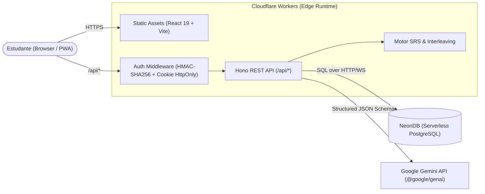

<div align="center">
  

  <h1>Cortex</h1>
  <p><strong>Sistema Pessoal de Estudos Ativos & Repetição Espaçada potencializado por IA</strong></p>
  <p>
    Construído para acelerar a transição <strong>Desenvolvedor Júnior → Pleno</strong> em JavaScript, TypeScript e Fundamentos de Engenharia de Software, combatendo o <em>cognitive offloading</em> (terceirização mental para IA) com ciência cognitiva aplicada.
  </p>

  <p>
    
    
    
    
    
    
    
    <a href="./LICENSE"></a>
  </p>
</div>

---

## Sumário

- [Sobre o Projeto](#sobre-o-projeto)
- [Pilares Pedagógicos (Ciência Cognitiva)](#pilares-pedagógicos-ciência-cognitiva)
- [Funcionalidades Principais](#funcionalidades-principais)
- [Trilha de Estudos (Currículo)](#trilha-de-estudos-currículo)
- [Arquitetura do Sistema](#arquitetura-do-sistema)
- [Stack Tecnológica](#stack-tecnológica)
- [Estrutura de Pastas](#estrutura-de-pastas)
- [Começando (Ambiente Local)](#começando-ambiente-local)
- [Variáveis de Ambiente](#variáveis-de-ambiente)
- [Scripts Disponíveis](#scripts-disponíveis)
- [Referência da API](#referência-da-api)
- [Deploy na Cloudflare Workers](#deploy-na-cloudflare-workers)
- [Referências Pedagógicas e Técnicas](#referências-pedagógicas-e-técnicas)
- [Licença](#licença)
- [Autor](#autor)

---

## Sobre o Projeto

No dia a dia de desenvolvimento moderno, entregar rápido usando assistentes de IA é ótimo para produtividade imediata, mas cria uma armadilha silenciosa: o **sedentarismo mental** — aceitar código pronto sem consolidar como o motor da linguagem, o protocolo HTTP ou o banco de dados funcionam por baixo dos panos.

O **Cortex** nasceu para inverter essa lógica: em vez de usar a IA como muleta que entrega respostas prontas, aqui **você explica o conceito com suas próprias palavras (sem consulta)** e o **Google Gemini** atua como um engenheiro sênior rigoroso que avalia sua explicação, aponta lacunas técnicas, faz perguntas de nível Pleno e gera desafios de *Code Review / Caça ao Bug*.

---

## Pilares Pedagógicos (Ciência Cognitiva)

O fluxo de estudo do Cortex foi desenhado sobre 5 princípios com forte respaldo empírico:

1. **Tópicos Atômicos e Granulares:**
   A trilha em [`data/roadmap.json`](./data/roadmap.json) divide o aprendizado em **5 módulos**, **30 tópicos independentes** e **162 sub-itens focados**, evitando sobrecarga de contexto na mesma sessão.
2. **Recuperação Ativa (*Active Recall*) + Técnica de Feynman:**
   Na sala de estudo, os conceitos-chave começam **ocultos por padrão**. Você escreve do zero o *"como"* e o *"porquê"* de cada sub-item antes de validar com a IA.
3. **Repetição Espaçada (*Spaced Repetition — SRS*):**
   Ao concluir o estudo de um tópico, você registra seu nível real de domínio e o algoritmo agenda automaticamente a próxima revisão:
   | Confiança | Ação no `streak` | Próxima Revisão | Status do Tópico |
   | :--- | :--- | :--- | :--- |
   | **Travei (`hard`)** | Reseta (`0`) | **+1 dia** | `learning` |
   | **Razoável (`medium`)** | Mantém atual | **+3 dias** | `reviewing` |
   | **Firme (`easy`)** | Incrementa (`+1`) | **7d → 15d → 30d → 60d** | `reviewing` (`mastered` com `streak ≥ 3`) |
4. **Prática Intercalada (*Interleaving*) + Trava Anti-Bola de Neve:**
   Mesmo que você fique dias sem abrir o app, a tela **Hoje** nunca exibe uma pilha intimidadora de pendências. Ela seleciona no máximo **2 revisões pendentes** (priorizando a mais atrasada e intercalando um módulo diferente na 2ª revisão) + **1 próximo tópico novo**.
5. **Teoria + Prática Manual:**
   Todo tópico acompanha uma sugestão de exercício prático sem autocompletar, marcação de prática concluída e um gerador sob demanda de **Desafios de Caça ao Bug / Code Review** realistas em TypeScript, JavaScript ou SQL.

---

## Funcionalidades Principais

- **Dashboard Diário Enxuto (`/`):** visão rápida de tópicos iniciados, dominados (`mastered`), práticas concluídas, revisões em dia e plano focado do dia.
- **Trilha Completa (`/trilha`):** visualização dos 5 módulos, metas de cada módulo, status, sequência de acertos (`streak`), última nota e data da próxima revisão.
- **Sala de Estudo Ativo (`/topico/:id`):**
  - Conceitos-chave com botão de revelar/ocultar para forçar recordação ativa;
  - Avaliação individual por sub-item com nota de `0` a `10`, pontos acertados, lacunas técnicas e pergunta desafiadora de entrevista/produção;
  - Recálculo automático da nota média do tópico a partir das tentativas mais recentes de cada sub-item;
  - Gerador de desafios práticos de código com **Dica (sem spoiler)** e **Solução comentada** sob demanda;
  - **Caderno de Evolução:** histórico expansível das tentativas anteriores gravado no banco.
- **PWA Instalável & Mobile-First:** manifesto configurado ([`public/site.webmanifest`](./public/site.webmanifest)) com tema escuro (`slate-950`) para estudar confortavelmente no computador ou celular.
- **Segurança Pessoal Single-User:** autenticação via chave de acesso (`APP_ACCESS_KEY`) com comparação em tempo constante (`SHA-256` + `XOR` via Web Crypto API contra *timing attacks*) e sessão em cookie `HttpOnly` assinado com `HMAC-SHA256`.
- **Inicialização Zero-Friction do Banco:** criação automática e idempotente das tabelas + sincronização (`UPSERT` preservando seu progresso) na primeira requisição se o banco estiver vazio.

---

## Trilha de Estudos (Currículo)

Definida em [`data/roadmap.json`](./data/roadmap.json) (**5 módulos · 30 tópicos · 162 sub-itens**):

| # | Módulo | Objetivo Prático | Tópicos |
| :-: | :--- | :--- | :-: |
| **1** | **JavaScript & TypeScript por baixo dos panos** | Entender como o motor executa código na memória, Call Stack, Event Loop, closures, imutabilidade, Generics e Type Narrowing. | 6 |
| **2** | **Estruturas de Dados, Algoritmos e Performance** | Bater o olho no código e prever escalabilidade usando Big O, Hash Maps (`Map`/`Set`), Stacks/Queues, recursão e ordenação. | 5 |
| **3** | **Engenharia Web, HTTP e APIs Robustas** | Dominar DNS/TLS/HTTP, REST, idempotência, validação de contratos na borda, autenticação/autorização e OWASP Top 10. | 6 |
| **4** | **Banco de Dados de Verdade (PostgreSQL/SQL + Cache)** | Modelar dados relacionais, escrever `JOIN`s, analisar `EXPLAIN ANALYZE`, evitar N+1, dominar transações ACID e estratégias de cache. | 6 |
| **5** | **Mentalidade de Pleno (Debugging, Testes e Arquitetura)** | Investigar bugs com método científico, tratar erros, testar regras críticas, instrumentar logs, usar filas e avaliar trade-offs de System Design. | 7 |

---

## Arquitetura do Sistema

Frontend SPA e Backend API rodam unificados na borda global da **Cloudflare Workers**, conectando-se ao **NeonDB (PostgreSQL Serverless)** e à API de **Interactions** do **Google Gemini**:



---

## Stack Tecnológica

| Camada | Tecnologias |
| :--- | :--- |
| **Frontend** | React 19, TypeScript 5.9, Vite 8, Tailwind CSS v4, React Router v7, Lucide Icons |
| **Backend / Edge** | Cloudflare Workers, `@cloudflare/vite-plugin`, Hono v4, Zod v4 |
| **Banco de Dados** | NeonDB PostgreSQL Serverless (`@neondatabase/serverless`), SQL nativo com migração idempotente |
| **Inteligência Artificial** | Google Gen AI SDK (`@google/genai`), Structured Outputs (`application/json` schema) |
| **Segurança** | Web Crypto API nativa (`HMAC-SHA256`, `SHA-256` constant-time check), Cookies `HttpOnly` / `SameSite=Lax` |
| **Qualidade & Testes** | Vitest v5 (testes unitários de SRS, Interleaving e Criptografia/Sessão), TypeScript Strict Mode |

---

## Estrutura de Pastas

```text
cortex/
├── data/
│   └── roadmap.json            # Currículo completo (5 módulos, 30 tópicos, 162 sub-itens)
├── db/
│   └── schema.sql              # DDL PostgreSQL de referência (tabelas topics e attempts)
├── public/                     # Assets estáticos, logo SVG e manifesto PWA
├── scripts/
│   └── seed.ts                 # Script CLI para criar schema e sincronizar roadmap no NeonDB
├── src/
│   ├── client/                 # Aplicação Frontend (React 19 + Tailwind CSS v4)
│   │   ├── components/         # Layout, CortexLogo, StatusBadge / ScoreBadge
│   │   ├── lib/                # Cliente HTTP tipado (api.ts) e formatadores de data/nota
│   │   └── pages/              # LoginPage, TodayPage, RoadmapPage, TopicStudyPage
│   ├── shared/
│   │   └── types.ts            # Contratos TypeScript compartilhados entre Client e Worker
│   └── worker/                 # Backend Serverless na Cloudflare Workers (Hono)
│       ├── auth.ts             # Token HMAC-SHA256 e comparação de senha em tempo constante
│       ├── db.ts               # Queries NeonDB, auto-schema e seed via UPSERT
│       ├── gemini.ts           # Avaliação Feynman e gerador de desafios com Google Gemini
│       ├── index.ts            # Rotas HTTP (/api/*), validações Zod e middlewares
│       └── srs.ts              # Cálculo de repetição espaçada e algoritmo do plano "Hoje"
├── tests/                      # Testes automatizados com Vitest (auth.test.ts, srs.test.ts)
├── PROJECT_SPEC.md             # Especificação original de produto e regras pedagógicas
├── wrangler.jsonc              # Configuração da Cloudflare Workers + SPA Static Assets
└── vite.config.ts              # Pipeline unificado React + Tailwind v4 + Cloudflare Plugin
```

---

## Começando (Ambiente Local)

### Pré-requisitos

- **Node.js** `20+` e **npm**
- Um banco PostgreSQL gratuito no [Neon](https://neon.tech/)
- Uma chave de API gratuita do [Google AI Studio (Gemini)](https://aistudio.google.com/)

### Passo a passo

1. **Clone o repositório e instale as dependências:**
   ```bash
   git clone https://github.com/danilo-humberto/cortex.git
   cd cortex
   npm install
   ```

2. **Configure as variáveis de ambiente locais:**
   ```bash
   # Linux / macOS / Git Bash
   cp .dev.vars.example .dev.vars

   # Windows (PowerShell)
   Copy-Item .dev.vars.example .dev.vars
   ```
   Edite o arquivo `.dev.vars` preenchendo suas credenciais (veja detalhes na seção [Variáveis de Ambiente](#variáveis-de-ambiente)).

3. **(Opcional) Popule o banco de dados manualmente:**
   ```bash
   npm run db:seed
   ```
   > **Nota:** Se preferir pular este passo, o próprio Worker cria as tabelas e sincroniza os 30 tópicos automaticamente na primeira requisição!

4. **Inicie o ambiente de desenvolvimento (Frontend + Cloudflare Worker juntos):**
   ```bash
   npm run dev
   ```
   Acesse `http://localhost:5173` no navegador e entre usando a senha definida em `APP_ACCESS_KEY`.

---

## Variáveis de Ambiente

Localmente, as variáveis ficam no arquivo `.dev.vars` (ignorado pelo Git). Em produção, são cadastradas como *Secrets* criptografados na Cloudflare.

| Variável | Obrigatória | Descrição |
| :--- | :-: | :--- |
| `DATABASE_URL` | Sim | Connection string PostgreSQL do NeonDB (com `?sslmode=require`). |
| `GEMINI_API_KEY` | Sim | Chave da API do Google Gemini gerada no Google AI Studio. |
| `APP_ACCESS_KEY` | Sim | Senha pessoal única usada na tela `/login` para proteger seu app e sua cota de IA. |
| `SESSION_SECRET` | Sim | String aleatória forte (mínimo recomendado: 32 caracteres) para assinar o cookie de sessão via `HMAC-SHA256`. |
| `GEMINI_MODEL` | Não | Sobrescreve o modelo padrão do Gemini configurado no Worker (padrão: `gemini-4-hydrogen`). |

---

## Scripts Disponíveis

| Comando | Descrição |
| :--- | :--- |
| `npm run dev` | Sobe o servidor Vite integrado ao runtime local da Cloudflare Workers (`workerd`). |
| `npm run db:seed` | Cria as tabelas no NeonDB (se não existirem) e faz `UPSERT` dos tópicos de `data/roadmap.json` preservando progresso. |
| `npm run typecheck` | Valida a tipagem TypeScript de todo o projeto (`client`, `worker` e configurações Node) sem emitir arquivos. |
| `npm test` | Executa a suíte de testes unitários com Vitest (`srs.test.ts` e `auth.test.ts`). |
| `npm run build` | Compila TypeScript e gera o bundle otimizado de produção (Client + Worker) em `dist/`. |
| `npm run deploy` | Executa o build completo e publica na Cloudflare Workers via Wrangler. |

---

## Referência da API

Todas as rotas sob `/api/*` (exceto `health` e `auth/*`) exigem o cookie de sessão `cortex_session` válido.

| Método | Endpoint | Descrição |
| :--- | :--- | :--- |
| `GET` | `/api/health` | Verifica status do serviço (`{ ok: true, service: "cortex" }`). |
| `GET` | `/api/auth/me` | Verifica se a sessão atual está autenticada. |
| `POST` | `/api/auth/login` | Valida `accessKey` em tempo constante e emite cookie `HttpOnly`. |
| `POST` | `/api/auth/logout` | Encerra a sessão removendo o cookie. |
| `GET` | `/api/dashboard` | Retorna métricas gerais e o plano **Estudo de Hoje** (até 2 revisões + 1 novo). |
| `GET` | `/api/topics` | Lista todos os 30 tópicos e seus agrupamentos por módulo. |
| `GET` | `/api/topics/:id` | Retorna detalhes do tópico, histórico de tentativas e prévia do intervalo `easy`. |
| `POST` | `/api/topics/:id/validate` | Avalia a explicação escrita (do tópico ou de um `itemId`) com o Google Gemini. |
| `POST` | `/api/topics/:id/review` | Salva a tentativa validada no histórico e atualiza nota/progresso. |
| `POST` | `/api/topics/:id/schedule` | Calcula e agenda a próxima revisão SRS (`hard`, `medium` ou `easy`). |
| `PATCH` | `/api/topics/:id/practice` | Marca ou desmarca a conclusão da prática manual (`practiceDone`). |
| `POST` | `/api/topics/:id/challenge` | Gera um desafio inédito de *Caça ao Bug / Code Review* via Gemini. |
| `POST` | `/api/seed` | Ressincroniza `data/roadmap.json` no banco preservando histórico e `streak`. |

---

## Deploy na Cloudflare Workers

1. **Faça login na sua conta Cloudflare pelo Wrangler:**
   ```bash
   npx wrangler login
   ```

2. **Cadastre os segredos de produção na Cloudflare:**
   ```bash
   npx wrangler secret put DATABASE_URL
   npx wrangler secret put GEMINI_API_KEY
   npx wrangler secret put APP_ACCESS_KEY
   npx wrangler secret put SESSION_SECRET
   ```

3. **Publique a aplicação (Frontend + API no mesmo Worker):**
   ```bash
   npm run deploy
   ```

---

## Referências Pedagógicas e Técnicas

- **Ciência da Aprendizagem:** *Dunlosky et al. (Improving Students' Learning With Effective Learning Techniques)* & *RetrievalPractice.org* — evidências sobre Recuperação Ativa, Prática Distribuída, Prática Intercalada e *Desirable Difficulties*.
- **IA & Formação de Habilidades:** Estudos sobre *Cognitive Offloading* (como evitar atrofia de raciocínio técnico ao trabalhar assistido por LLMs).
- **Engenharia de Software:** *roadmap.sh* (JavaScript, TypeScript, Backend, PostgreSQL) & *The Pragmatic Engineer* (autonomia técnica na transição Júnior → Pleno).
- Especificação detalhada de concepção do MVP disponível em [`PROJECT_SPEC.md`](./PROJECT_SPEC.md).

---

## Licença

Este projeto está licenciado sob a **Licença MIT** — veja o arquivo [`LICENSE`](./LICENSE) para mais detalhes.

---

## Autor

<div align="center">
  <a href="https://github.com/danilo-humberto">
    
    <br />
    <sub><strong>Danilo Humberto</strong></sub>
  </a>
  <br />
  <br />
  <a href="https://github.com/danilo-humberto">
    
  </a>
  <br />
  <br />
  <sub>Desenvolvido com foco em estudos consistentes, ativos e sem atalhos mentais.</sub>
</div>
